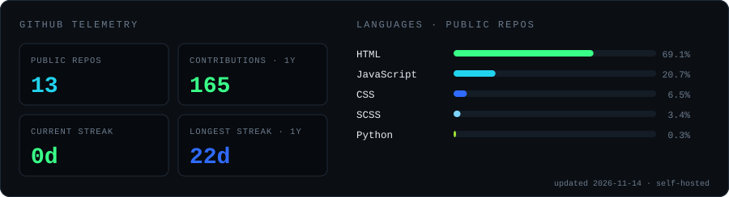
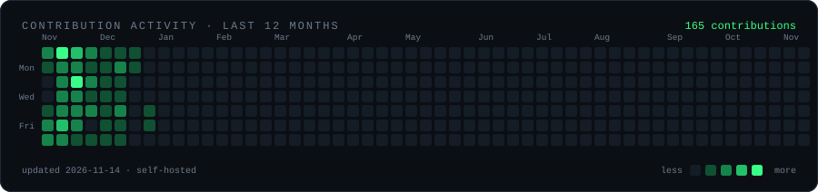

<div align="center">



<br/>

**I build reliable automation frameworks, validate APIs, investigate defects,<br/>and help deliver high-quality software through intelligent testing.**

<br/>

[](https://www.linkedin.com/in/uday-punia-000b60253/)
[](mailto:udaypunia9027@gmail.com)
[](https://uday-punia-portfolio.vercel.app/)

</div>


## Bug Hunting, Automated

<picture>
  <source media="(prefers-reduced-motion: reduce)" srcset="assets/images/bug-scanner-static.png" />
  
</picture>


## About Me
<sub><code>$ whoami</code></sub>

I'm a **QA Automation Engineer with 2+ years in software testing**, focused on making quality something a team can measure and repeat, not just hope for.

- **Quality assurance end to end:** test planning, test case design and execution, and clear, reproducible defect reports that developers can act on quickly.
- **UI automation:** Selenium WebDriver with Java, and Playwright with JavaScript/TypeScript, built on the Page Object Model so suites stay readable as they grow.
- **API testing:** validating requests, responses, status codes, auth and JSON contracts with Postman and REST Assured.
- **Framework thinking:** reusable utilities, data-driven tests, fixtures and hooks, and reports that show *why* a test failed, not just that it did.
- **CI/CD:** running suites on every change so regressions surface in the pipeline instead of in production.


## Testing Arsenal
<sub><code>$ ls ./arsenal --by-category</code></sub>

<p align="center">
  &nbsp;&nbsp;
  &nbsp;&nbsp;
  &nbsp;&nbsp;
  &nbsp;&nbsp;
  &nbsp;&nbsp;
  &nbsp;&nbsp;
  &nbsp;&nbsp;
  &nbsp;&nbsp;
  &nbsp;&nbsp;
  &nbsp;&nbsp;
  &nbsp;&nbsp;
  &nbsp;&nbsp;
  
</p>

<p align="center"><sub><b>◆</b> core · used regularly &nbsp;&nbsp;|&nbsp;&nbsp; <b>◇</b> hands-on · built and practised with &nbsp;&nbsp;|&nbsp;&nbsp; <b>○</b> learning · actively studying</sub></p>

| Area | Toolkit |
|:--|:--|
| **UI Automation** | Selenium WebDriver ◆ · Playwright ◆ |
| **Programming** | Java ◆ · JavaScript ◆ · TypeScript ○ |
| **API Testing** | Postman ◆ · REST Assured ◇ · SoapUI ○ |
| **Frameworks & Patterns** | TestNG ◆ · Page Object Model ◆ · JUnit ◇ · Data-Driven ◇ · Hybrid ◇ |
| **Performance** | Apache JMeter ◇ |
| **Build & Dependencies** | Maven ◆ · npm ◆ |
| **CI/CD & DevOps** | GitHub Actions ◇ · Jenkins ◇ · Linux ◇ · Docker ○ |
| **Databases** | SQL ◇ · MySQL ◇ · MongoDB ◇ |
| **Reporting** | Allure Reports ◇ · Extent Reports ◇ |
| **Version Control** | Git ◆ · GitHub ◆ |
| **Dev Tools** | VS Code ◆ · IntelliJ IDEA ◆ · Eclipse ◇ |

**Testing methodologies:** Manual · Functional · Regression · Smoke · Sanity · Integration · Cross-Browser · End-to-End · Bug Reporting · SDLC · STLC


## Featured QA Automation Projects
<sub><code>$ cat ./projects/manifest.log</code></sub>

<table>
<tr>
<td width="50%" valign="top">

### Playwright Automation Framework


End-to-end UI and API tests for the OrangeHRM demo application, built as a maintainable framework rather than a set of scripts.

**Stack:** Playwright · JavaScript · Node.js<br/>
**Scope:** Page Object Model · fixtures and hooks · parallel and cross-browser runs · HTML reports with screenshots and traces · CI integration

<sub>Repository and README: publishing soon</sub>

</td>
<td width="50%" valign="top">

### Selenium Automation Framework


A Java hybrid framework for a web storefront: data-driven flows, stable explicit waits and readable reporting.

**Stack:** Java · Selenium WebDriver · TestNG · Maven<br/>
**Scope:** Page Object Model · explicit waits · data-driven tests · Extent reporting

<sub>Planned project</sub>

</td>
</tr>
<tr>
<td width="50%" valign="top">

### API Automation Framework


Contract-level checks for a REST API: CRUD flows, authentication, and schema validation that catches breaking changes early.

**Stack:** Java · REST Assured · TestNG · Postman<br/>
**Scope:** request/response validation · authentication · status codes · JSON schema validation

<sub>Planned project</sub>

</td>
<td width="50%" valign="top">

### Performance Testing Suite


Load and stress profiles for a web application, with reports that turn response-time data into clear findings.

**Stack:** Apache JMeter<br/>
**Scope:** load testing · stress testing · thresholds · HTML performance reports

<sub>Planned project</sub>

</td>
</tr>
</table>


## GitHub Telemetry
<sub><code>$ git log --stat --since="1 year ago"</code></sub>





<sub>Built from public GitHub data by <a href="scripts/generate-stats.mjs"><code>scripts/generate-stats.mjs</code></a> and stored in this repo, so no third-party stats service can break these cards.</sub>


## Currently Working On
<sub><code>$ tail -f ./focus.log</code></sub>

```text
[ACTIVE]    Building Playwright automation frameworks
[ACTIVE]    Strengthening Selenium WebDriver with Java
[LEARNING]  Advanced API automation with REST Assured
[PRACTICE]  Framework architecture + reusable test utils
[LEARNING]  CI/CD integration for test suites
[PRACTICE]  Debugging, traces and test reporting
```


<div align="center">

**Open to QA Automation / SDET roles.** Let's talk about quality.

[](https://www.linkedin.com/in/uday-punia-000b60253/)
[](mailto:udaypunia9027@gmail.com)

<sub><code>exit 0 · all checks passed · no bugs escaped</code></sub>

</div>
